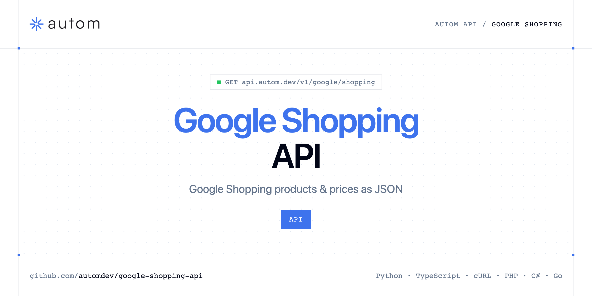

<p align="center">
  <a href="https://www.autom.dev"></a>
</p>

# Google Shopping API

[](https://discord.gg/CFj3ph8aHU) [](https://app.autom.dev/register) [](https://docs.autom.dev) [](LICENSE)

The **Autom Google Shopping API** returns Google Shopping product listings — titles, prices, merchants, ratings — as structured JSON.

- **Google Shopping API** — Scrape Google Shopping results via API and retrieve structured product listings with prices, ratings, and merchant data.

Use it for price monitoring, assortment benchmarks or product research.

| Endpoint | Request | Credits |
|---|---|---|
| [Google Shopping API](#google-shopping-api) | `GET /v1/google/shopping` | 1 |

## Table of contents

- [How it works](#how-it-works)
- [Google Shopping API](#google-shopping-api)
- [Code examples in other languages](#code-examples-in-other-languages)
- [Use cases](#use-cases)
- [Why Autom?](#why-autom)
- [FAQ](#faq)
- [Related repositories](#related-repositories)
- [Support](#support)

## How it works

1. **Create a Autom account** and copy your API key from the [dashboard](https://app.autom.dev/register).
2. **Call `https://api.autom.dev`** with the header `x-api-key: YOUR_API_KEY`.
3. **Use the result** in your app — no infrastructure to run.

```bash
export AUTOM_API_KEY="your-api-key"
pip install requests        # Python
# TypeScript: Node.js 18+ (native fetch), run with `npx tsx file.ts`
```

## Google Shopping API

Scrape Google Shopping results via API and retrieve structured product listings with prices, ratings, and merchant data.

`GET https://api.autom.dev/v1/google/shopping` · **1 credit per request** · [API reference](https://app.autom.dev/openapi)

### Request parameters

| Parameter | In | Type | Required | Description |
|---|---|---|---|---|
| `query` | query | string | ✅ | Query to search on Google Shopping (product name, brand, category). |
| `page` | query | number | — | Page number for pagination (1 = first page). |
| `gl` | query | string | — | Country to use (two-letter country code, e.g. `us`, `fr`). |
| `hl` | query | string | — | Language to use (two-letter language code, e.g. `en`, `fr`). |
| `location` | query | string | — | Location to localize results (e.g. `New York, United States`). Generates a UULE parameter automatically. |
| `uule` | query | string | — | Encoded location parameter (UULE). Use `location` instead if you don't have a pre-encoded value. |
| `safe` | query | string | — | Adult content filter. `active` enables Google SafeSearch; `off` disables it. Omit to use Google default. |

### Python example

```python
import os

import requests

API_KEY = os.environ["AUTOM_API_KEY"]
HEADERS = {"x-api-key": API_KEY}

response = requests.get(
    "https://api.autom.dev/v1/google/shopping",
    headers=HEADERS,
    params={
        "query": "playstation 5",
    },
    timeout=120,
)
response.raise_for_status()

data = response.json()
print(data)
```

### TypeScript example

```typescript
type GoogleShoppingApi = {
  organic_results?: {
    link?: string;
    price?: string;
    title?: string;
    rating?: number;
    source?: string;
    position?: number;
    image_url?: string;
    product_id?: string;
    rating_count?: number;
  }[];
  search_parameters?: {
    q?: string;
    gl?: string;
    hl?: string;
    page?: number;
    type?: string;
    uule?: unknown;
    engine?: string;
    location?: unknown;
  };
};

const headers = { "x-api-key": process.env.AUTOM_API_KEY!, "Content-Type": "application/json" };

const params = new URLSearchParams({
  "query": "playstation 5",
});

const response = await fetch(`https://api.autom.dev/v1/google/shopping?${params}`, { headers });
if (!response.ok) throw new Error(`HTTP ${response.status}: ${await response.text()}`);

const data = (await response.json()) as GoogleShoppingApi;
console.log(data);
```

### Output example

Example response from the API reference, abridged.

```json
{
  "organic_results": [
    {
      "link": "https://www.google.com/shopping/product/13889492455424928753",
      "price": "$399.00",
      "title": "Sony PlayStation 5 Console",
      "rating": 4.6,
      "source": "PlayStation",
      "position": 1,
      "image_url": "data:image/webp;base64,UklGRhImAABXRUJQVlA4IAYmAAAQfwCdASrMAOAAPl0kj0UjoiEWqy6EOAXEoA0MSYrne2yLnl3wI9uaZVyl2D++8nfo7zq/8P1sfoz0WfPR9b3mU/…",
      "product_id": "10252959786065141094",
      "rating_count": 14000
    },
    {
      "link": "https://www.google.com/shopping/product/683017410702969826",
      "price": "$473.98",
      "title": "Sony PlayStation 5 Console Digital Edition",
      "rating": 4.6,
      "source": "Walmart - VoltHeavenAMZ",
      "position": 2,
      "image_url": "data:image/webp;base64,UklGRuQVAABXRUJQVlA4INgVAADwYgCdASrMAPsAPkEcjESioaERyLXsKAQEs7dvWAcKgW8yt8bv3Lvslf4DaVfYZ5i/5N/Xv93/RPfA9G3/Xx7n9m…",
      "product_id": "10252959786065141094",
      "rating_count": 15000
    }
  ],
  "search_parameters": {
    "q": "playstation 5",
    "gl": "us",
    "hl": "en",
    "page": 1,
    "type": "shopping",
    "uule": null,
    "engine": "google",
    "location": null
  }
}
```

### Response fields

| Field | Type | Description |
|---|---|---|
| `organic_results[]` | object[] |  |
| `organic_results[].link` | string |  |
| `organic_results[].price` | string |  |
| `organic_results[].title` | string |  |
| `organic_results[].rating` | number |  |
| `organic_results[].source` | string |  |
| `organic_results[].position` | integer |  |
| `organic_results[].image_url` | string |  |
| `organic_results[].product_id` | string |  |
| `organic_results[].rating_count` | integer |  |
| `search_parameters` | object |  |
| `search_parameters.q` | string |  |
| `search_parameters.gl` | string |  |
| `search_parameters.hl` | string |  |
| `search_parameters.page` | integer |  |
| `search_parameters.type` | string |  |
| `search_parameters.uule` | object |  |
| `search_parameters.engine` | string |  |
| `search_parameters.location` | object |  |

## Code examples in other languages

Ready-to-run examples live in [`examples/`](examples); each reads your key from `AUTOM_API_KEY`.

| Language | `google-shopping` |
|---|---|
| cURL (Bash) | [google_shopping.sh](examples/curl/google_shopping.sh) |
| PHP | [google_shopping.php](examples/php/google_shopping.php) |
| C# | [GoogleShopping.cs](examples/csharp/GoogleShopping.cs) |
| Go | [google_shopping.go](examples/go/google_shopping.go) |
| Java | [GoogleShoppingExample.java](examples/java/GoogleShoppingExample.java) |
| Ruby | [google_shopping.rb](examples/ruby/google_shopping.rb) |
| Node.js | [google_shopping.mjs](examples/nodejs/google_shopping.mjs) |

## Use cases

- **Price monitoring** — Compare prices across merchants.
- **Product research** — Spot trending products and sellers.

## Why Autom?

- **Every SERP in one API** — Google Search, AI Mode, Maps, News, Shopping, Images, Videos, Jobs, Autocomplete, plus Bing and Brave.
- **Structured JSON** — documented fields instead of brittle HTML parsing.
- **Geo & language targeting** — search like a user from the country and language you need.
- **One API key, one header** — `x-api-key` on every request.
- **Copy-paste examples** — Python and TypeScript in each README, 7 more languages in `examples/`.

## FAQ

### How do I authenticate?

Create an account on [Autom](https://app.autom.dev/register), copy your API key and send it in the `x-api-key` header of every request to `https://api.autom.dev`.

### How much does a request cost?

Credits per call: `/v1/google/shopping` **1**. See [Autom pricing](https://www.autom.dev/pricing).

### Which languages are supported?

Any language that can make an HTTP request. This README shows Python and TypeScript; the [`examples/`](examples) folder contains cURL, PHP, C#, Go, Java, Ruby and Node.js.

## Related repositories

- [Google Search API](https://github.com/automdev/google-search-api)
- [Google AI Mode API](https://github.com/automdev/google-ai-mode-api)
- [Google Maps API](https://github.com/automdev/google-maps-api)
- [Google News API](https://github.com/automdev/google-news-api)
- [Google Images API](https://github.com/automdev/google-images-api)
- [Google Videos API](https://github.com/automdev/google-videos-api)
- [Google Jobs API](https://github.com/automdev/google-jobs-api)
- [Google Autocomplete API](https://github.com/automdev/google-autocomplete-api)
- [All Autom repositories](https://github.com/automdev)

## Support

- 💬 Join the [Discord](https://discord.gg/CFj3ph8aHU) to ask questions and share what you build.
- 📚 Read the [API reference](https://docs.autom.dev).
- 🔑 [Get your API key](https://app.autom.dev/register).

---

<p align="center">
  <a href="https://www.autom.dev">
    <picture>
      <source media="(prefers-color-scheme: dark)" srcset="images/logo-dark.svg">
      
    </picture>
  </a>
  <br>
  <sub>Built by <a href="https://www.autom.dev">Autom</a>. Examples are released under the MIT license.</sub>
</p>
